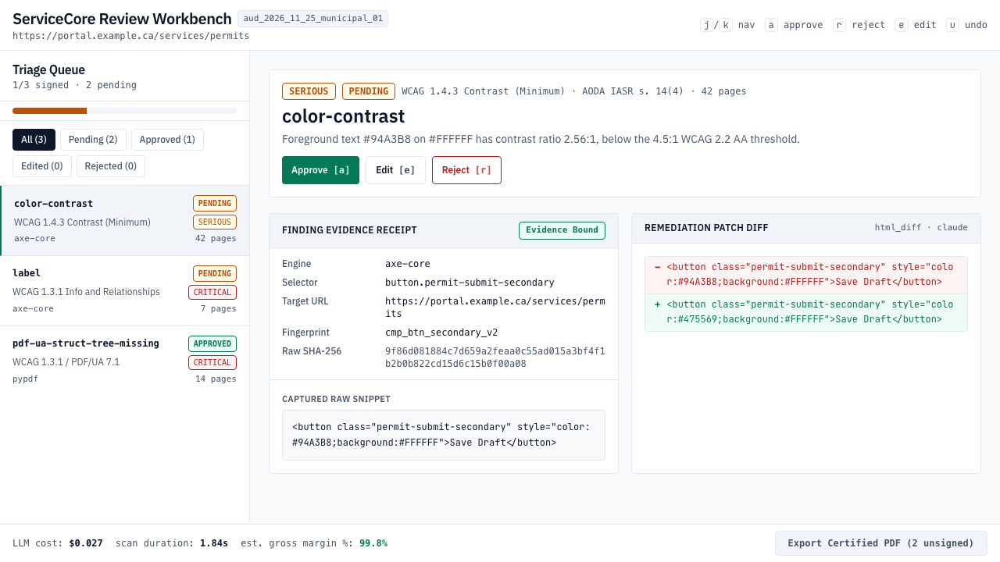

# ServiceCore: Evidence-Bound AODA/WCAG 2.2 Accessibility Audit & Remediation Workbench

[](https://github.com/creova-gif/servicecore/actions/workflows/ci.yml)
[](LICENSE)
[](pyproject.toml)
[](workbench/package.json)
[](CHANGELOG.md)



## Overview

ServiceCore is an AI-native compliance delivery platform for **AODA / WCAG 2.2 Web and PDF/UA accessibility audits**. Every finding is captured deterministically, bound to cryptographic evidence, reviewed by a human engineer, and exported as a SHA-256 signed audit bundle.

- **Spec & Review Ledger:** [PROJECT_SPEC.md](PROJECT_SPEC.md)
- **Design Doc & UI Spec:** [docs/designs/servicecore-platform.md](docs/designs/servicecore-platform.md), [DESIGN.md](DESIGN.md)
- **Standards & Security:** [AGENTS.md](AGENTS.md), [docs/adr/001-dual-engine-evidence-architecture.md](docs/adr/001-dual-engine-evidence-architecture.md), [docs/THREAT_MODEL.md](docs/THREAT_MODEL.md)

## Key Features

- **Dual-Engine Deterministic Scanners (Wave 1):** Playwright + `axe-core` DOM accessibility scanner (`WebAxeScanner`) and `pypdf` structural PDF/UA inspector (`PdfUaInspector`) with SSRF/public-URL validation and per-finding `component_fingerprint` + `raw_scanner_sha256` digests.
- **Same-Origin BFS Crawl (Waves 4–5):** Bounded multi-page and PDF discovery (`src/servicecore/crawler.py`) integrated into the CLI, FastAPI `POST /audits`, and Workbench scan form (`crawl`, `max_pages`, `max_pdfs`).
- **Evidence-Bound Claude Synthesis (Wave 1):** `ClaudeSynthesizer` generates `RemediationPatch` payloads (`html_diff` or `pdf_tag_action`) with deterministic template fallback when no API key is configured, and `validate_patch_binding` rejects any selector, rule, or unsafe HTML drift.
- **SHA-256 Export Gate (Waves 1–3):** `sign_bundle` and `verify_bundle` require every non-rejected finding to be `APPROVED` or `EDITED` before computing the canonical SHA-256 `evidence_digest`.
- **Certified PDF, HTML, SARIF 2.1.0 & GitHub Issues (Waves 1–7):** Export signed bundles to WeasyPrint Certified PDF, HTML reports, SARIF `2.1.0` (`src/servicecore/sarif.py`, `GET /audits/{audit_id}/export/sarif`) for GitHub Code Scanning, or publish directly to GitHub Issues (`src/servicecore/github_publisher.py`).
- **Recurring Monitors & Webhook Regression Alerts (Waves 5–7):** `MonitorSchedule` persistence, `/monitors` API endpoints, due-monitor scheduler loop, baseline regression diffing (`+N new`, `-N resolved`, `N persisting`, `N reopened`), and SSRF-safe signed webhook alerts (`src/servicecore/alerts.py`).
- **Next.js Review Workbench (Waves 2–7):** Keyboard-first triage UI (`j`/`k`/`a`/`r`/`e` shortcuts, `< 1024px` responsive drawer, `44x44px` touch targets), inline GitHub publishing, Recurring Monitors panel, SARIF download, and Cost & Margin telemetry footer.

## Architecture

ServiceCore separates deterministic capture from AI-assisted remediation synthesis ([ADR-001](docs/adr/001-dual-engine-evidence-architecture.md)):

1. **Lane A — Deterministic Scanners (`src/servicecore/scanners.py`, `src/servicecore/crawler.py`):**
   - `WebAxeScanner`: Playwright + `axe-core` DOM accessibility scanner with SSRF/public-URL validation.
   - `PdfUaInspector`: `pypdf` structural PDF/UA inspector (`PDF_UNTAGGED_DOCUMENT`, `PDF_MISSING_LANG`, `PDF_MISSING_TITLE`, `PDF_FIGURE_MISSING_ALT`, `PDF_TABLE_MISSING_HEADERS`, `PDF_MISSING_TAB_ORDER`).
   - `crawl_site`: Same-origin BFS crawler for bounded multi-page and PDF discovery.
2. **Lane B — Evidence-Bound Synthesis (`src/servicecore/synthesizer.py`):**
   - `ClaudeSynthesizer` generates `RemediationPatch` payloads with deterministic template fallback when `ANTHROPIC_API_KEY` is unset.
   - `validate_patch_binding` raises `EvidenceMismatchError` if a synthesized patch alters `rule_id`, `target_selector`, `wcag_criterion`, or `aoda_section`, or introduces unsafe HTML (`<script>`, `on*=`, `javascript:` URIs).
3. **Human Sign-Off, Monitoring & Export (`src/servicecore/exporter.py`, `src/servicecore/sarif.py`, `src/servicecore/alerts.py`, `src/servicecore/api.py`, `workbench/`):**
   - **FastAPI Backend (`src/servicecore/api.py`):** `org_id`-scoped HMAC-SHA256 bearer auth, `InMemoryAuditStore` / `SQLiteAuditStore`, audit CRUD + diff + SARIF/PDF/GitHub exports, `/monitors` scheduling, and `POST /webhooks/stripe`.
   - **Next.js Review Workbench (`workbench/`):** Triage UI for inspecting findings, approving/editing patches, running recurring monitors, and downloading signed exports.

## Installation & Usage

### 1. Environment & Static Checks
```bash
uv venv --python 3.12 .venv
uv pip install --python .venv/bin/python ".[dev]"
.venv/bin/mypy src/ evals/ tests/
.venv/bin/ruff check src/ evals/ tests/
.venv/bin/pytest -v
```

### 2. CLI (`audit`, `verify`, `diff`, `sarif`)
```bash
# Audit a web URL or PDF file and export a signed bundle
.venv/bin/servicecore audit path/to/doc.pdf --out bundle.json --sign-reviewer justin

# Verify canonical SHA-256 evidence_digest integrity
.venv/bin/servicecore verify bundle.json

# Diff baseline vs current snapshots for recurring monitoring
.venv/bin/servicecore diff baseline.json current.json

# Export a signed AuditBundle to SARIF 2.1.0 JSON
.venv/bin/servicecore sarif bundle.json --out results.sarif
```

### 3. FastAPI Backend (Local Dev)
```bash
SERVICECORE_DEV_MODE=1 .venv/bin/uvicorn servicecore.api:create_app --factory --host 127.0.0.1 --port 8000
```

### 4. Next.js Review Workbench
```bash
cd workbench
npm install
npm run dev
```

### 5. Docker Compose
```bash
docker compose up --build
```

### 6. Offline Partner Demo
```bash
.venv/bin/python scripts/demo_partner_audit.py
```

## Configuration

| Variable | Description | Default / Example |
| --- | --- | --- |
| `SERVICECORE_AUTH_SECRET` | HMAC-SHA256 signing secret for bearer tokens (required outside dev mode) | `""` |
| `SERVICECORE_DB_PATH` | SQLite database path for `SQLiteAuditStore` | `/data/servicecore.sqlite` |
| `SERVICECORE_DEV_MODE` | Set to `1` to allow local dev token minting and in-memory fallback | `0` (`1` in `docker-compose.yml`) |
| `SERVICECORE_CORS_ORIGINS` | Comma-separated allowed CORS origins for the FastAPI backend | `http://localhost:3000,http://localhost:3105` |
| `STRIPE_WEBHOOK_SECRET` | Signing secret for `POST /webhooks/stripe` signature verification | `""` |
| `ANTHROPIC_API_KEY` | Anthropic API key for `ClaudeSynthesizer` (uses deterministic templates if unset) | `""` |
| `NEXT_PUBLIC_SERVICECORE_API_URL` | Base URL used by the Next.js Workbench API client | `http://localhost:8000` |

## Reproducible Benchmark Results

Observed locally on the 5 deterministic SMB web/PDF fixtures in `evals/corpus.py` via `evals/runner.py`:

```bash
.venv/bin/python -c "from evals.runner import run_smb_benchmark; print(run_smb_benchmark())"
```

| Metric | Observed Value |
| --- | --- |
| `sites_evaluated` | `5` |
| `precision` | `1.0` |
| `recall` | `1.0` |
| `unverified_claims` | `0` |
| `total_duration_ms` | `317` |

Full Python test suite (`.venv/bin/pytest -q`): **83 passed**.

## Contributing & License

- See [CONTRIBUTING.md](CONTRIBUTING.md) for development workflow, static checks, and PR guidelines.
- Licensed under the [MIT License](LICENSE).
